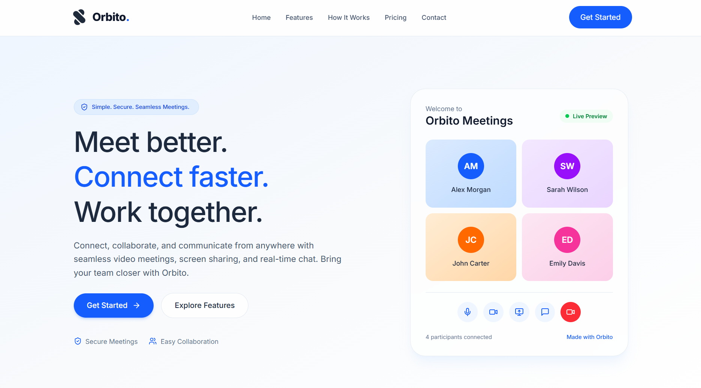
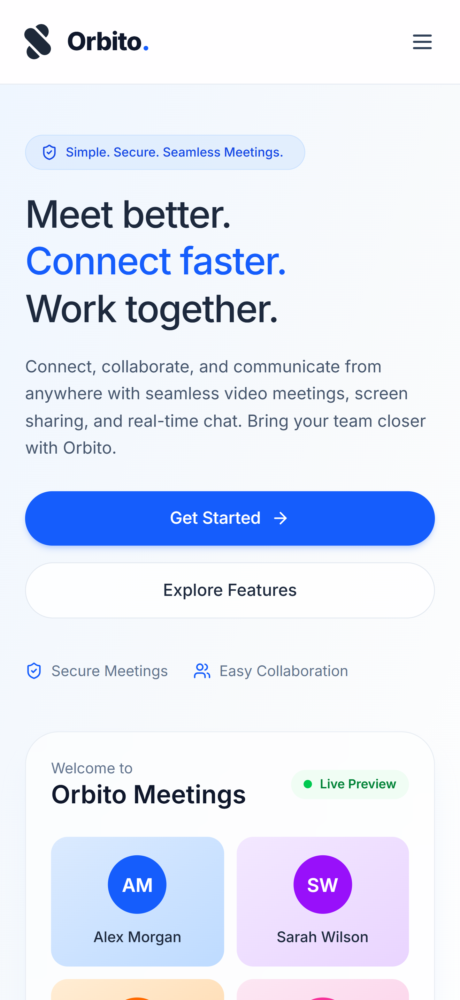
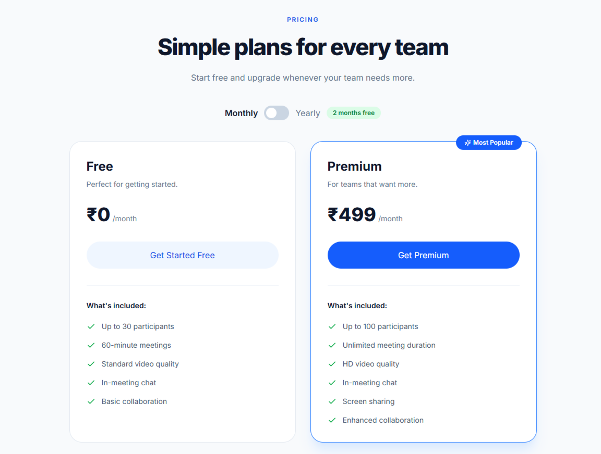
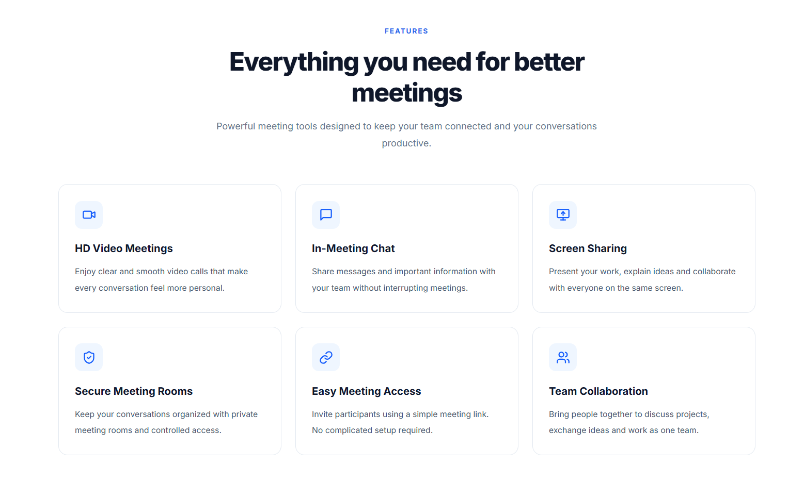

# Orbito – Video Conferencing Platform

Orbito is a modern and responsive SaaS landing page for a video conferencing platform. It is designed to present the product, highlight its key features, explain how it works, and showcase available pricing plans.

The landing page focuses on a clean user interface, simple navigation, and a responsive experience across desktop, tablet, and mobile devices.

## Live Demo

[View Live Website](https://sankargroupassignment.vercel.app/)

## Screenshots

### Desktop View


### Mobile View


### Pricing Section


### Features Section


## Features

- Responsive navigation with mobile menu
- Hero section with product introduction and call-to-action buttons
- Features section highlighting the platform's capabilities
- How It Works section explaining the meeting process
- Product preview showing a sample video meeting interface
- Pricing section with Free and Premium plans
- Monthly and yearly pricing toggle
- Contact form with input validation and success feedback
- Responsive layout for different screen sizes

## Tech Stack

- **React.js** – Building the user interface
- **JavaScript** – Application logic and interactivity
- **Tailwind CSS** – Styling and responsive layouts
- **Vite** – Development server and build tool
- **Lucide React** – Icons

## Getting Started

Follow these steps to run the project locally.

### Prerequisites

- Node.js
- npm
- Git

### Installation

1. Clone the repository:

   ```bash
   git clone https://github.com/Shivam-RN/SankarGroup-Assignment.git
   ```

2. Navigate to the project directory:

   ```bash
   cd SankarGroup-Assignment
   ```

3. Install dependencies:

   ```bash
   npm install
   ```

4. Start the development server:

   ```bash
   npm run dev
   ```

5. Open the local URL provided by Vite in your browser.

### Production Build

To create an optimized production build, run:

```bash
npm run build
```

## Project Structure

```text
orbito-landing/
├── public/
├── src/
│   ├── components/
│   ├── App.jsx
│   ├── main.jsx
│   └── index.css
├── screenshots/
├── index.html
├── package.json
├── vite.config.js
└── README.md
```

## Project Purpose

This project was developed as part of a Front-End Development Internship assignment. The objective was to build a modern SaaS landing page using React and Tailwind CSS while focusing on responsive design, reusable components, and user-friendly interactions.

## Note

This is a frontend demonstration project. The contact form displays a success message but is not connected to a backend service. Pricing plans are presented for demonstration purposes.